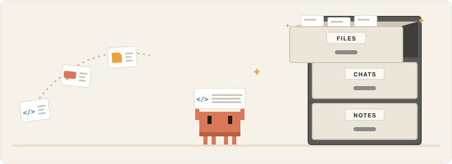
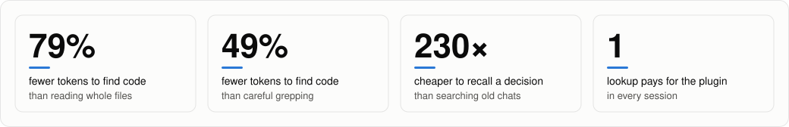
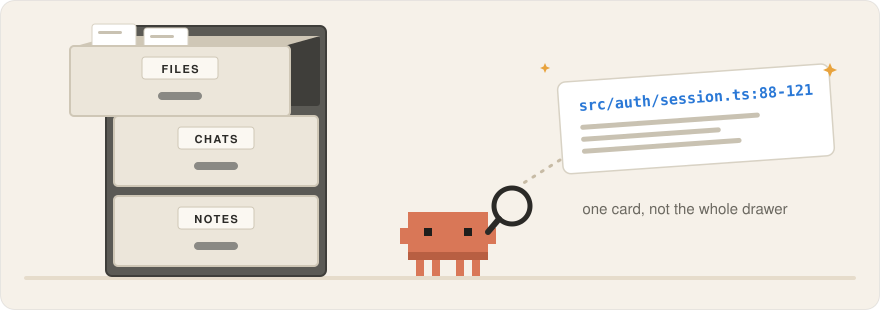
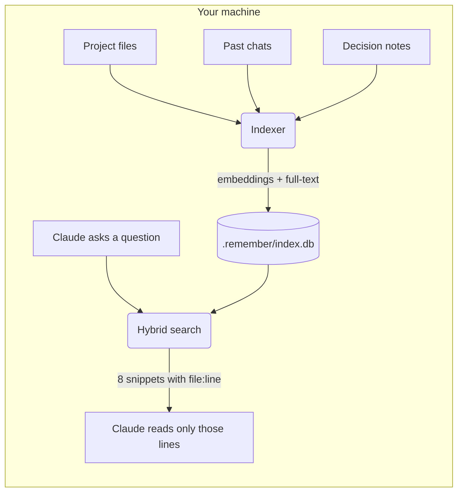
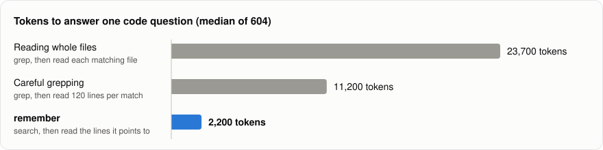
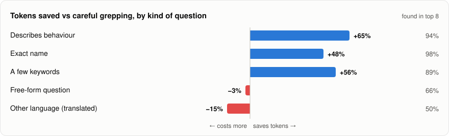
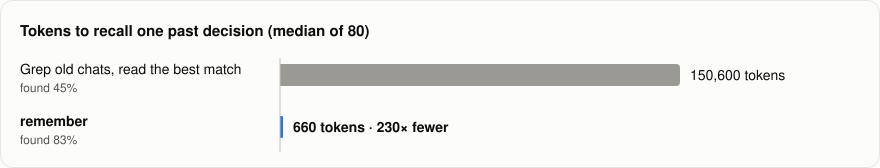

<div align="center">

# remember

**A local memory for Claude Code.**<br>
Your project's files, your past chats and the decisions you made, searchable in one step and never sent anywhere.

[](https://github.com/BartaLazar/remember/actions/workflows/test.yml)
[](LICENSE)
[](https://nodejs.org)


<br>

<picture>
  <source media="(prefers-color-scheme: dark)" srcset="docs/img/filing-dark.svg">
  
</picture>

</div>

---

Every new Claude Code session starts from zero. Claude greps, opens whole files to find ten relevant lines, and asks again about things you settled last week. That costs tokens, time and patience.

**remember** gives Claude a knowledge base of the project it is working in. Before reading files, Claude asks it a question and gets back a handful of short snippets with exact `file:line` pointers, then reads only those lines. Decisions you made in earlier sessions come back too, with their reasons and dates.

It sets itself up. Install it, open a project, and indexing starts in the background.

<picture>
  <source media="(prefers-color-scheme: dark)" srcset="docs/img/hero-dark.svg">
  
</picture>

<sub>Measured over 684 simulated lookups on five real codebases and a synthetic project history. [How we measured](#how-much-does-it-save).</sub>

## Contents

- [Install](#install)
- [What it looks like](#what-it-looks-like)
- [What gets remembered](#what-gets-remembered)
- [How it works](#how-it-works)
- [How much does it save?](#how-much-does-it-save)
  - [Finding code](#finding-code) · [Remembering decisions and past chats](#remembering-decisions-and-past-chats) · [What it costs](#what-it-costs)
- [Asking efficiently](#asking-efficiently)
  - [Where the tokens go](#where-the-tokens-go) · [Keywords that change how the search behaves](#9-keywords-that-change-how-the-search-behaves) · [Quick reference](#quick-reference)
- [Using it](#using-it)
- [Privacy](#privacy)
- [Your data: the `.remember/` folder](#your-data-the-remember-folder)
- [Settings and safeguards](#settings-and-safeguards)
- [Platforms](#platforms)
- [Troubleshooting](#troubleshooting)
- [Development](#development)
- [License](#license)

## Install

```
/plugin marketplace add BartaLazar/remember
/plugin install remember@remember
```

That's it. You need **Node.js 22.13 or newer** on your `PATH`.

The first session downloads the embedding model once (about 120 MB). Until it arrives, search still works with keyword matching and says so.

## What it looks like

You ask Claude something about your project:

> **You:** Where do we handle expired refresh tokens, and didn't we decide something about retries?

Claude searches before it opens any file, and gets back:

```
[1] src/auth/session.ts:88-121
export async function refresh(token: RefreshToken) {
  if (token.expiresAt < Date.now()) {
    throw new SessionExpiredError(token.userId);
  ...

[2] note "No automatic retry on refresh failure" (2026-10-12)
Retrying a failed refresh hid revoked sessions from users. On failure we sign the user out. ...

[3] src/auth/errors.ts:14-30 — CHANGED SINCE INDEXED, re-read before trusting
export class SessionExpiredError extends Error {
  ...
```

Then it reads lines 88–121 of one file instead of the whole `auth/` folder, and remembers the decision without being told twice.

<picture>
  <source media="(prefers-color-scheme: dark)" srcset="docs/img/finding-dark.svg">
  
</picture>

<sub>Example output. The format is what the plugin returns; the code and note are made up.</sub>

## What gets remembered

| Source | What is indexed | Kept fresh by |
|---|---|---|
| **Files** | Every text file in the project, respecting `.gitignore`. Binaries, files over 1 MB and secret files (`.env*`, keys, certificates, credentials) are always skipped. | Re-indexing each file Claude edits, plus a quick change check at the start of every session. |
| **Chats** | Your past Claude Code conversations in this project: what you asked and what Claude answered. Tool output is left out, and common secret patterns (API keys, tokens, passwords, connection strings) are masked before anything is stored. | Adding each session when it ends. |
| **Decision notes** | Short notes Claude saves when you settle something: the decision, the reason and the date. They rank above other results, and a newer note can replace an older one. | You and Claude, as you work. |

## How it works



- **Hybrid search.** Every query runs twice: once by meaning, with a multilingual embedding model, and once by exact words with SQLite full-text search. The two rankings are merged, so it finds both "where do we log people out" and `SessionExpiredError`.
- **Multilingual.** The model, [`multilingual-e5-small`](https://huggingface.co/intfloat/multilingual-e5-small), understands about 100 languages, so notes and chats in any language are searchable. For code, ask in the language its names and comments use (see the measurements below).
- **Small answers.** A search returns at most 8 short snippets, about 1,500 tokens, so the lookup itself never becomes the expensive part.
- **Honest about staleness.** If a file changed after it was indexed, its result says so, and Claude re-reads it before trusting it.
- **Never in the way.** Hooks start the indexer as a detached, low-priority background process and return immediately. Only one indexer runs per project at a time.
- **Incremental.** Only content whose hash changed gets re-embedded.

## How much does it save?

**Most of the cost of a question is reading files, and remember cuts most of the reading.** To measure it without spending a single API token, we simulated 684 lookups: each Claude session is modelled as the tool calls it would make, and the tokens in every tool's output are counted. The plugin's real index, search and embedding model are used. Scripts and raw results are in [`bench/`](bench/).

### Finding code

604 questions on five real codebases: [express](https://github.com/expressjs/express) (JavaScript), [flask](https://github.com/pallets/flask) (Python), [gin](https://github.com/gin-gonic/gin) (Go), [ripgrep](https://github.com/BurntSushi/ripgrep) (Rust) and this repo.

<picture>
  <source media="(prefers-color-scheme: dark)" srcset="docs/img/code-tokens-dark.svg">
  
</picture>

> **78% fewer tokens than reading whole files, 47% fewer than careful grepping, in about half the tool calls.**

The right place was in the top 8 results for 89% of questions. The other 11% fall back to normal exploration; those wasted searches are counted in every number here.

**How you ask matters.** Names and descriptions of behaviour save the most. Broad "how does X work" questions break even, and asking about code in another language than the code costs more:

<picture>
  <source media="(prefers-color-scheme: dark)" srcset="docs/img/by-type-dark.svg">
  
</picture>

<details>
<summary><b>Show the numbers</b></summary>

<br>

| | Tokens per lookup (median) | Tool calls (mean) | Total tokens, all 604 |
|---|--:|--:|--:|
| Without, reading whole files | 23,700 | 5.2 | 17.7 M |
| Without, careful grepping | 11,200 | 10.0 | 7.3 M |
| **With remember** | **2,200** | **2.6** | **3.9 M** |

| Kind of question | Example | Found in top 8 | Saved vs whole files | Saved vs careful |
|---|---|--:|--:|--:|
| Describes behaviour | "returns a middleware that recovers from any panics and writes a 500 if there was one" | 94% | 85% | 65% |
| A few keywords | "middleware recovers panics writes" | 89% | 81% | 56% |
| Exact name | "where is `Recovery` defined" | 98% | 83% | 48% |
| Free-form developer question | "how does flask decide which config file to load" | 66% | 58% | −3% |
| In another language than the code | "Wie berechnet Express den ETag für eine Antwort?" | 13% | 8% | −72% |

</details>

### Remembering decisions and past chats

80 questions about 60 decisions buried in 40 past sessions (19 MB of chat logs) and 25 decision notes.

<picture>
  <source media="(prefers-color-scheme: dark)" srcset="docs/img/decisions-dark.svg">
  
</picture>

> **230× fewer tokens, and the answer found almost twice as often.**

- Decisions also saved as notes were found **88%** of the time, against 79% for decisions that only exist in chat.
- Questions in German, Dutch, French or Spanish found the answer 73% of the time.
- A file of decisions loaded into every session (like `CLAUDE.md`) costs nothing to search and never misses, but grows with every entry. Past about **125 decisions** it costs more per session than searching them.

### What it costs

The plugin adds **about 450 tokens** to every session (skill descriptions, tool names and one line of context), or about 1,050 if Claude Code loads all tool definitions upfront. One code lookup saves about 9,000 tokens against even careful grepping, so:

> **The first lookup of a session pays for the plugin. Everything after that is savings.**

Indexing runs on your machine and costs no tokens.

<sub>Method: tokens are estimated as characters ÷ 4 for every approach alike. The simulated agent stops as soon as it has read the answer and picks the right result when it is shown, which flatters both sides. The chat history is generated from templates, so real recall is probably somewhat lower. Full details and caveats in [`bench/results`](bench/results/). Charts are generated by [`bench/charts.js`](bench/charts.js).</sub>

## Asking efficiently

remember makes lookups cheaper, but it can't make them free. Each search costs tokens, and a question the search can't answer costs the search plus the normal exploration that follows. How you phrase a question decides which of those you get.

Below: what to ask, how to word it, and when to skip the search entirely. The numbers come from the simulations above.

### Where the tokens go

| What Claude does | Tokens (median) |
|---|--:|
| Greps, then reads whole files until it finds the answer | 23,700 |
| Greps, then reads 120 lines around each match | 11,200 |
| Searches remember, then reads the lines it points to | 2,200 |
| Searches remember for a past decision | 660 |
| Reads the exact lines you named | a few hundred |

Two things follow from this table:

- **Reading is the expensive part, not searching.** Anything that tells Claude where to read saves the most.
- **The cheapest question is one that needs no search at all.** If you already know where something is, say so.

### 1. Use names when you have them

A function, class, file or config key name is the strongest signal you can give.

| Instead of | Ask |
|---|---|
| "Where's the thing that retries failed uploads?" | "Where is `retryUpload` defined?" |
| "How do we handle the session cookie?" | "How does `SessionStore.refresh` work?" |
| "What's that setting for the queue size?" | "What is `MAX_QUEUE_DEPTH` set to and why?" |

Exact names found the right place in the top 8 results **98%** of the time, and ranked it first **79%** of the time. Names with a capital in the middle, an underscore or a digit (`retryUpload`, `max_depth`, `v2`) are recognised as code. For plain lowercase names, add "defined" or "implemented": *"where is `range` defined"*.

### 2. Otherwise, describe what the code does, in its own words

When you don't know the name, describe the behaviour using words that would appear in the code or its comments.

| Instead of | Ask |
|---|---|
| "Why does the app crash sometimes?" | "Where do we recover from panics and return a 500?" |
| "How does auth work?" | "Where are expired refresh tokens rejected?" |
| "Explain the upload stuff" | "Where are uploads split into chunks before sending?" |

Behaviour descriptions found the right place **94%** of the time. A few distinctive keywords work nearly as well (**89%**): *"stale lock heartbeat"*, *"middleware recovers panics"*.

### 3. Break open-ended questions into concrete ones

"How does X work?" is the weakest kind of question. It found the right place only **66%** of the time, and saved nothing compared with careful grepping. There's rarely a single place that answers it.

Split it into the parts you actually want to know:

> ~~How does caching work in this project?~~
>
> Where is the cache created? → What decides when an entry expires? → Where is it invalidated after a write?

Each concrete question lands on one place, and each answer gives you the names to use in the next one.

### 4. Ask about code in the language the code is written in

The embedding model understands about 100 languages, but questions about English code in another language almost always miss: **13%** found the right place. Use the language of the names and comments.

Notes and chats are different. They are prose, and questions in German, Dutch, French or Spanish found past decisions **73%** of the time.

### 5. If you know where it is, skip the search

A search costs about 2,000 tokens even when it succeeds. Point Claude straight at the place and it reads only that.

| Instead of | Ask |
|---|---|
| "Find where we validate emails and fix the regex" | "Fix the email regex in `src/validate.ts` around line 40" |
| "Look at the deploy script" | "Read `scripts/deploy.sh` lines 1–60" |

You don't need the exact line. A file name alone already saves the search.

### 6. Recalling decisions: use the subject, not the date

Past decisions are found by what they were about, not by when they happened.

| Instead of | Ask |
|---|---|
| "What did we decide last Tuesday?" | "What did we decide about pagination?" |
| "Remind me what we said earlier" | "Why did we choose Postgres over SQLite?" |
| "What was that thing about the queue?" | "What do we use for the job queue, and why?" |

Decisions were found **83%** of the time for about 660 tokens each. Grepping old chat logs instead cost around 150,000 tokens and found the answer less than half the time.

### 7. Save decisions so future questions are cheap

A decision saved as a note was found **88%** of the time, against **79%** for one that only exists somewhere in a chat. Notes also rank above everything else.

When you settle something, ask Claude to remember it, and include:

- **The subject in plain words** that you'd later search for: "pagination", "job queue", "Node version".
- **The decision and the reason.** "Cursor pagination, because offsets slowed down past a million rows."
- **Names from the code**, if any: `listOrders`, `PAGE_SIZE`.

When a decision changes, say that it replaces the old one. The old note then disappears from search, so Claude can't act on it by mistake.

> "Remember: we switched the job queue from Redis to Postgres `LISTEN/NOTIFY`, to drop a dependency. This replaces the earlier Redis decision."

### 8. Narrow the search when you know what you want

If you only want past decisions, or only code, say so. Results from the other sources won't crowd the answer.

- *"Search only our notes: what's our policy on breaking API changes?"*
- *"Only in the code, not old chats: where is the rate limit set?"*

### 9. Keywords that change how the search behaves

A few words switch the search into a different mode. Use them on purpose.

| Keyword in your question | What it does | Example |
|---|---|---|
| **defined**, **definition**, **declared**, **implemented** | Treats the question as a code lookup: question words are ignored, and the place where the name is defined ranks above places that only use it. | "where is `range` defined" |
| A **code-like name** (`retryUpload`, `max_depth`, `v2`) | Same code-lookup mode, triggered by the name itself. | "how does `retryUpload` back off" |
| **test**, **tests**, **spec**, **specs** | Test files are no longer ranked down. Leave these words out when you want the real implementation. | "which tests cover `retryUpload`" |
| **notes**, **saved decisions** | Claude searches only your decision notes. | "search our notes for the API versioning policy" |
| **chats**, **earlier sessions**, **we discussed** | Claude searches only past conversations. | "in earlier sessions, what did we say about flaky CI?" |
| **code**, **files**, **docs** | Claude searches only the project's files. | "only in the code: where is the timeout set?" |
| **remember** | Claude saves a decision note. | "remember: we pin Node 22 because…" |
| **replaces**, **instead of**, **we changed our mind** | When saving, Claude marks the old note as replaced, and the old note drops out of search. | "remember: cursor pagination, replacing the offset decision" |
| **forget** | Claude removes a file, folder or chat from the index and keeps it out. | "forget `legacy/**`" |

**Words that are ignored in code lookups:** where, is, how, does, what, which, the, find, show, code, function, method, defined, implemented, and similar question words. They match almost every file, so in code-lookup mode only your real keywords count. In plain-language questions about decisions, every word is kept, because there they help.

The first three rows are built into the search itself. The rest work because the plugin's skills tell Claude how to react to them, so other phrasings with the same meaning work too.

### 10. Habits outside the plugin

These are general Claude Code habits. They aren't measured here, but each one keeps the conversation shorter, and a shorter conversation costs less on every turn.

- **One task per conversation.** Run `/clear` when you switch to something unrelated. Claude can find what it needs again through remember.
- **Keep `CLAUDE.md` short.** It's loaded into every session. Put the handful of rules that matter every time there, and let remember hold the rest. In the simulation, a decision file past about 125 entries cost more per session than searching it.
- **Say what you want back.** "Just the file and line" or "a one-paragraph answer" stops Claude from reading more than the answer needs.

### Quick reference

| You have… | Ask like this | Found |
|---|---|--:|
| A name | "Where is `retryUpload` defined?" | 98% |
| A description of what the code does | "Where do we recover from panics and return a 500?" | 94% |
| A few keywords | "stale lock heartbeat" | 89% |
| A broad "how does X work" | Split into concrete questions first | 66% |
| A file and roughly where | "Read `src/x.ts` around line 80" | no search needed |
| A past decision | "What did we decide about pagination?" | 83% |
| A decision just made | "Remember: … because … (replaces …)" | 88% later |

**Keywords to keep handy:** *defined* · *implemented* · *tests* (only when you want tests) · *notes* · *earlier sessions* · *only in the code* · *remember* · *replaces* · *forget*

<sub>"Found" means the right place was among the 8 results a search returns. Figures come from simulations with synthetic and open-source data; real results vary by project. Method and caveats: [`bench/`](bench/).</sub>

## Using it

Most of the time you do nothing: Claude reaches for the knowledge base by itself. You can also just ask:

| Say something like | What happens |
|---|---|
| "What did we decide about pagination?" | Claude searches your notes and past chats (`recall`). |
| "Remember that we never retry payment webhooks, because…" | Claude saves a decision note (`remember`). |
| "Is the index up to date?" | Progress, counts, model state and threshold (`status`). |
| "Rebuild the index" | Full background rebuild (`index`). |
| "Forget `legacy/**`" or "Forget that chat session" | Removed now and kept out from then on (`forget`). |
| "Turn remember off for this project" | The plugin stops working in this project until you turn it back on (`forget`). |

<details>
<summary><b>The five skills and six tools</b></summary>

<br>

**Skills** teach Claude when to use the knowledge base:

| Skill | Purpose |
|---|---|
| `recall` | Search before reading, grepping or globbing files. |
| `remember` | Save a decision, convention or constraint with its reason. |
| `index` | Build or refresh the index; change the size threshold. |
| `status` | Show what is indexed and whether it is current. |
| `forget` | Exclude or remove content; switch the plugin off or on for a project. |

**MCP tools** do the work: `search`, `save_note`, `reindex`, `status`, `configure`, `forget`.

**Hooks:** `SessionStart` (refresh changed files and tell Claude the knowledge base exists), `PostToolUse` on edits (re-index the touched file), `SessionEnd` (index the finished chat).

</details>

## Privacy

remember was built with one rule: **your project never leaves your machine.**

- The plugin only goes online to install: the one-time model download from Hugging Face and, if Claude Code's own dependency install failed, the packages from the npm registry. These only fetch files.
- After the model is cached, everything runs offline. A test ([`test/offline.test.js`](test/offline.test.js)) indexes and searches with all network access blocked, and fails on any attempt to connect.
- Files, chats and notes never leave the project's `.remember/` folder.
- Chat text is stored with common secret patterns redacted.
- The plugin never sends your files, chats, notes or any other data to an external service or third party. What the operating system or its runtimes do on their own (for example Windows diagnostic data) is outside the plugin's scope.

## Your data: the `.remember/` folder

Each project gets its own `.remember/` folder in its root. It contains a `.gitignore` of its own, so git never sees the folder and nothing in it ends up in a commit.

| File | What it is |
|---|---|
| `notes.jsonl` | Your decision notes. **The one file worth backing up.** Everything else can be rebuilt. |
| `exclusions.json` | What you asked `forget` to keep out. |
| `index.db` | The search index (SQLite). Safe to delete; it is rebuilt. |
| `worker.log` | Log of the background indexer. |
| `status.json`, `lock`, `pending.jsonl` | Internal indexer state. |
| `off` | Only exists if you turned the plugin off for this project. |

## Settings and safeguards

**Large projects.** If a project has more than 5,000 indexable files, the first build waits and Claude asks you what to do: index everything, skip this project, or change the threshold. Once you say yes, everything is indexed, with no cap. To change the threshold, tell Claude, for example *"set the remember threshold to 20000"*. `0` means never ask. The setting is global and lives in `config.json` in the plugin's data folder.

**Folders it won't index automatically.** Filesystem roots, your home folder, and `~/Desktop`, `~/Documents` and `~/Downloads` themselves are never indexed on their own. Their subfolders are fine. Ask Claude to index one of them and it will.

**Off switch.** Ask Claude to turn remember off for a project, or create an empty `.remember/off` file. Delete it to turn the plugin back on.

## Platforms

| | macOS (Apple silicon) | macOS (Intel) | Linux | Windows |
|---|:-:|:-:|:-:|:-:|
| Supported | ✓ | ✓ | ✓ | ✓ |
| Tested in CI on Node 22 and 24 | ✓ | ✓ | ✓ (x64) | ✓ (x64) |

## Troubleshooting

<details>
<summary><b>Search only returns keyword results</b></summary>

<br>

The embedding model is still downloading or the download failed. Make sure you are online once, then start a new session. Ask Claude for the index `status` to see whether the model is present.
</details>

<details>
<summary><b>Results seem stale, wrong or missing</b></summary>

<br>

Ask Claude for the index `status`. It shows the project root, progress, counts and exclusions. If something looks off, ask Claude to rebuild the index. Indexer errors are written to `.remember/worker.log`.
</details>

<details>
<summary><b>"Dependencies are missing" at session start</b></summary>

<br>

Claude Code's automatic install did not finish, so the plugin installs the dependencies in the background and is ready next session. The log is `install.log` in the plugin's data folder. If that install fails too, run `npm ci --omit=dev` in the plugin folder that the message names.
</details>

<details>
<summary><b>"Needs Node.js 22.13 or newer"</b></summary>

<br>

The plugin uses Node's built-in SQLite, which arrived in 22.13. Install a current Node.js LTS and make sure `node -v` shows it in the shell Claude Code starts from.
</details>

## Development

```
npm ci
npm test
claude plugin validate --strict
```

Tests that need the real model skip themselves when it is not cached. CI runs the full suite on macOS (Apple silicon and Intel), Linux and Windows, each with Node 22 and 24.

<details>
<summary><b>Why the dependencies are pinned</b></summary>

<br>

`@huggingface/transformers` is pinned to 4.3.2 and `onnxruntime-node` is overridden to 1.23.2. From 1.24, `onnxruntime-node` dropped macOS Intel (x64) binaries. 1.23.2 still ships macOS x64 and arm64, Linux and Windows, so the plugin runs on all of them.
</details>

Design notes are in [`docs/design.md`](docs/design.md).

## License

[MIT](LICENSE) © Bart Alazar
