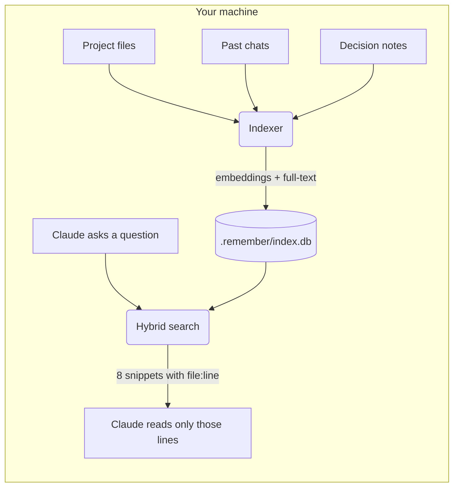

<div align="center">

# remember

**A local memory for Claude Code.**<br>
Your project's files, your past chats and the decisions you made, searchable in one step and never sent anywhere.

[](https://github.com/BartaLazar/remember/actions/workflows/test.yml)
[](LICENSE)
[](https://nodejs.org)


</div>

---

Every new Claude Code session starts from zero. Claude greps, opens whole files to find ten relevant lines, and asks again about things you settled last week. That costs tokens, time and patience.

**remember** gives Claude a knowledge base of the project it is working in. Before reading files, Claude asks it a question and gets back a handful of short snippets with exact `file:line` pointers, then reads only those lines. Decisions you made in earlier sessions come back too, with their reasons and dates.

It sets itself up. Install it, open a project, and indexing starts in the background.

## Install

```
/plugin marketplace add BartaLazar/remember
/plugin install remember@remember
```

That's it. You need **Node.js 22.13 or newer** on your `PATH`.

The first session downloads the embedding model once (about 120 MB). Until it arrives, search still works with keyword matching and says so.

## What it looks like

You ask Claude something about your project:

> **You:** Where do we handle expired refresh tokens, and didn't we decide something about retries?

Claude searches before it opens any file, and gets back:

```
[1] src/auth/session.ts:88-121
export async function refresh(token: RefreshToken) {
  if (token.expiresAt < Date.now()) {
    throw new SessionExpiredError(token.userId);
  ...

[2] note "No automatic retry on refresh failure" (2026-10-12)
Retrying a failed refresh hid revoked sessions from users. On failure we sign the user out. ...

[3] src/auth/errors.ts:14-30 — CHANGED SINCE INDEXED, re-read before trusting
export class SessionExpiredError extends Error {
  ...
```

Then it reads lines 88–121 of one file instead of the whole `auth/` folder, and remembers the decision without being told twice.

<sub>Example output. The format is what the plugin returns; the code and note are made up.</sub>

## What gets remembered

| Source | What is indexed | Kept fresh by |
|---|---|---|
| **Files** | Every text file in the project, respecting `.gitignore`. Binaries, files over 1 MB and secret files (`.env*`, keys, certificates, credentials) are always skipped. | Re-indexing each file Claude edits, plus a quick change check at the start of every session. |
| **Chats** | Your past Claude Code conversations in this project: what you asked and what Claude answered. Tool output is left out, and common secret patterns (API keys, tokens, passwords, connection strings) are masked before anything is stored. | Adding each session when it ends. |
| **Decision notes** | Short notes Claude saves when you settle something: the decision, the reason and the date. They rank above other results, and a newer note can replace an older one. | You and Claude, as you work. |

## How it works



- **Hybrid search.** Every query runs twice: once by meaning, with a multilingual embedding model, and once by exact words with SQLite full-text search. The two rankings are merged, so it finds both "where do we log people out" and `SessionExpiredError`.
- **Multilingual.** The model, [`multilingual-e5-small`](https://huggingface.co/intfloat/multilingual-e5-small), understands about 100 languages, so notes and chats in any language are searchable. For code, ask in the language its names and comments use (see the measurements below).
- **Small answers.** A search returns at most 8 short snippets, about 1,500 tokens, so the lookup itself never becomes the expensive part.
- **Honest about staleness.** If a file changed after it was indexed, its result says so, and Claude re-reads it before trusting it.
- **Never in the way.** Hooks start the indexer as a detached, low-priority background process and return immediately. Only one indexer runs per project at a time.
- **Incremental.** Only content whose hash changed gets re-embedded.

## How much does it save?

We simulated 684 lookups to find out, without spending a single API token: each Claude session is modelled as the sequence of tool calls it would make, and the tokens in every tool's output are counted. The plugin's real index, search and embedding model are used. Scripts and raw results are in [`bench/`](bench/).

### Finding code

604 questions on five real codebases: [express](https://github.com/expressjs/express) (JavaScript), [flask](https://github.com/pallets/flask) (Python), [gin](https://github.com/gin-gonic/gin) (Go), [ripgrep](https://github.com/BurntSushi/ripgrep) (Rust) and this repo. Without the plugin, Claude greps and then reads either whole files (*typical*) or a 120-line window around each match (*careful*).

| | Tokens per lookup (median) | Tool calls (mean) | Total tokens, all 604 |
|---|--:|--:|--:|
| Without, typical | 23,700 | 5.2 | 17.7 M |
| Without, careful | 11,200 | 10.0 | 7.3 M |
| **With remember** | **2,200** | **2.6** | **3.9 M** |

That is **78% fewer tokens than typical exploration and 47% fewer than careful exploration**, in about half the tool calls. The right place was in the top 8 results for 89% of questions; the other 11% fall back to normal exploration, and those searches are wasted cost that the totals above include.

Savings depend on how you ask:

| Kind of question | Example | Found in top 8 | Saved vs typical | Saved vs careful |
|---|---|--:|--:|--:|
| Describes behaviour | "returns a middleware that recovers from any panics and writes a 500 if there was one" | 94% | 85% | 65% |
| A few keywords | "middleware recovers panics writes" | 89% | 81% | 56% |
| Exact name | "where is `Recovery` defined" | 98% | 83% | 48% |
| Free-form developer question | "how does flask decide which config file to load" | 66% | 58% | −3% |
| In another language than the code | "Wie berechnet Express den ETag für eine Antwort?" | 13% | 8% | −72% |

### Remembering decisions and past chats

80 questions about 60 decisions buried in 40 past sessions (19 MB of chat logs) and 25 decision notes.

| | Tokens per question (median) | Finds the answer |
|---|--:|--:|
| Grep the old chat logs and read the best match | 150,600 | 45% |
| **remember** | **660** | **83%** |

- Decisions also saved as notes were found **88%** of the time, against 79% for decisions that only exist in chat.
- Questions in German, Dutch, French or Spanish found the answer 73% of the time.
- A file of decisions loaded into every session (like `CLAUDE.md`) costs nothing to search and never misses, but grows with every entry. Past about **125 decisions** it costs more per session than searching them.

### What it costs

The plugin adds **about 450 tokens** to every session (skill descriptions, tool names and one line of context), or about 1,050 if Claude Code loads all tool definitions upfront. One code lookup saves about 9,000 tokens against even careful exploration, so **the first lookup of a session pays for the plugin**. Indexing runs locally and costs no tokens.

### Getting the most out of it

The full guide, with example questions and the keywords that change how search behaves, is in **[Asking questions efficiently](docs/asking-efficiently.md)**. The short version:

- **Ask by name or by behaviour.** Exact names ("where is `Recovery` defined") and descriptions of what code does both work well. Open-ended "how does X work" questions are about level with careful grepping.
- **Ask about code in the language the code is written in.** Notes and chats work across languages; code mostly doesn't.
- **Save decisions as notes.** They are found more reliably than the same decision buried in a chat, and they rank first.
- **Supersede, don't pile up.** When a decision changes, save a note that replaces the old one; the old note then disappears from search. In chats, newer conversations get a small ranking boost, which put the newer decision above the old one in all 10 test cases.
- **Keep `CLAUDE.md` short.** Put the handful of rules that matter every session there, and let remember hold everything else.

<sub>Method: tokens are estimated as characters ÷ 4 for every policy alike. The simulated agent stops as soon as it has read the answer and picks the right result when it is shown, which flatters both sides. The chat history is generated from templates, so real recall is probably somewhat lower. Full details and caveats in [`bench/results`](bench/results/).</sub>

## Using it

Most of the time you do nothing: Claude reaches for the knowledge base by itself. You can also just ask:

| Say something like | What happens |
|---|---|
| "What did we decide about pagination?" | Claude searches your notes and past chats (`recall`). |
| "Remember that we never retry payment webhooks, because…" | Claude saves a decision note (`remember`). |
| "Is the index up to date?" | Progress, counts, model state and threshold (`status`). |
| "Rebuild the index" | Full background rebuild (`index`). |
| "Forget `legacy/**`" or "Forget that chat session" | Removed now and kept out from then on (`forget`). |
| "Turn remember off for this project" | The plugin stops working in this project until you turn it back on (`forget`). |

<details>
<summary><b>The five skills and six tools</b></summary>

<br>

**Skills** teach Claude when to use the knowledge base:

| Skill | Purpose |
|---|---|
| `recall` | Search before reading, grepping or globbing files. |
| `remember` | Save a decision, convention or constraint with its reason. |
| `index` | Build or refresh the index; change the size threshold. |
| `status` | Show what is indexed and whether it is current. |
| `forget` | Exclude or remove content; switch the plugin off or on for a project. |

**MCP tools** do the work: `search`, `save_note`, `reindex`, `status`, `configure`, `forget`.

**Hooks:** `SessionStart` (refresh changed files and tell Claude the knowledge base exists), `PostToolUse` on edits (re-index the touched file), `SessionEnd` (index the finished chat).

</details>

## Privacy

remember was built with one rule: **your project never leaves your machine.**

- The plugin only goes online to install: the one-time model download from Hugging Face and, if Claude Code's own dependency install failed, the packages from the npm registry. These only fetch files.
- After the model is cached, everything runs offline. A test ([`test/offline.test.js`](test/offline.test.js)) indexes and searches with all network access blocked, and fails on any attempt to connect.
- Files, chats and notes never leave the project's `.remember/` folder.
- Chat text is stored with common secret patterns redacted.
- The plugin never sends your files, chats, notes or any other data to an external service or third party. What the operating system or its runtimes do on their own (for example Windows diagnostic data) is outside the plugin's scope.

## Your data: the `.remember/` folder

Each project gets its own `.remember/` folder in its root. It contains a `.gitignore` of its own, so git never sees the folder and nothing in it ends up in a commit.

| File | What it is |
|---|---|
| `notes.jsonl` | Your decision notes. **The one file worth backing up.** Everything else can be rebuilt. |
| `exclusions.json` | What you asked `forget` to keep out. |
| `index.db` | The search index (SQLite). Safe to delete; it is rebuilt. |
| `worker.log` | Log of the background indexer. |
| `status.json`, `lock`, `pending.jsonl` | Internal indexer state. |
| `off` | Only exists if you turned the plugin off for this project. |

## Settings and safeguards

**Large projects.** If a project has more than 5,000 indexable files, the first build waits and Claude asks you what to do: index everything, skip this project, or change the threshold. Once you say yes, everything is indexed, with no cap. To change the threshold, tell Claude, for example *"set the remember threshold to 20000"*. `0` means never ask. The setting is global and lives in `config.json` in the plugin's data folder.

**Folders it won't index automatically.** Filesystem roots, your home folder, and `~/Desktop`, `~/Documents` and `~/Downloads` themselves are never indexed on their own. Their subfolders are fine. Ask Claude to index one of them and it will.

**Off switch.** Ask Claude to turn remember off for a project, or create an empty `.remember/off` file. Delete it to turn the plugin back on.

## Platforms

| | macOS (Apple silicon) | macOS (Intel) | Linux | Windows |
|---|:-:|:-:|:-:|:-:|
| Supported | ✓ | ✓ | ✓ | ✓ |
| Tested in CI on Node 22 and 24 | ✓ | ✓ | ✓ (x64) | ✓ (x64) |

## Troubleshooting

<details>
<summary><b>Search only returns keyword results</b></summary>

<br>

The embedding model is still downloading or the download failed. Make sure you are online once, then start a new session. Ask Claude for the index `status` to see whether the model is present.
</details>

<details>
<summary><b>Results seem stale, wrong or missing</b></summary>

<br>

Ask Claude for the index `status`. It shows the project root, progress, counts and exclusions. If something looks off, ask Claude to rebuild the index. Indexer errors are written to `.remember/worker.log`.
</details>

<details>
<summary><b>"Dependencies are missing" at session start</b></summary>

<br>

Claude Code's automatic install did not finish, so the plugin installs the dependencies in the background and is ready next session. The log is `install.log` in the plugin's data folder. If that install fails too, run `npm ci --omit=dev` in the plugin folder that the message names.
</details>

<details>
<summary><b>"Needs Node.js 22.13 or newer"</b></summary>

<br>

The plugin uses Node's built-in SQLite, which arrived in 22.13. Install a current Node.js LTS and make sure `node -v` shows it in the shell Claude Code starts from.
</details>

## Development

```
npm ci
npm test
claude plugin validate --strict
```

Tests that need the real model skip themselves when it is not cached. CI runs the full suite on macOS (Apple silicon and Intel), Linux and Windows, each with Node 22 and 24.

<details>
<summary><b>Why the dependencies are pinned</b></summary>

<br>

`@huggingface/transformers` is pinned to 4.3.2 and `onnxruntime-node` is overridden to 1.23.2. From 1.24, `onnxruntime-node` dropped macOS Intel (x64) binaries. 1.23.2 still ships macOS x64 and arm64, Linux and Windows, so the plugin runs on all of them.
</details>

Design notes are in [`docs/design.md`](docs/design.md).

## License

[MIT](LICENSE) © Bart Alazar
